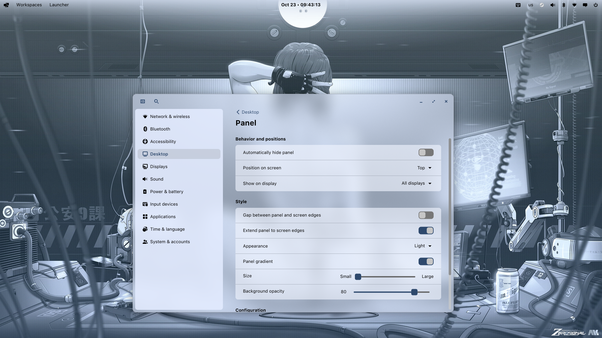
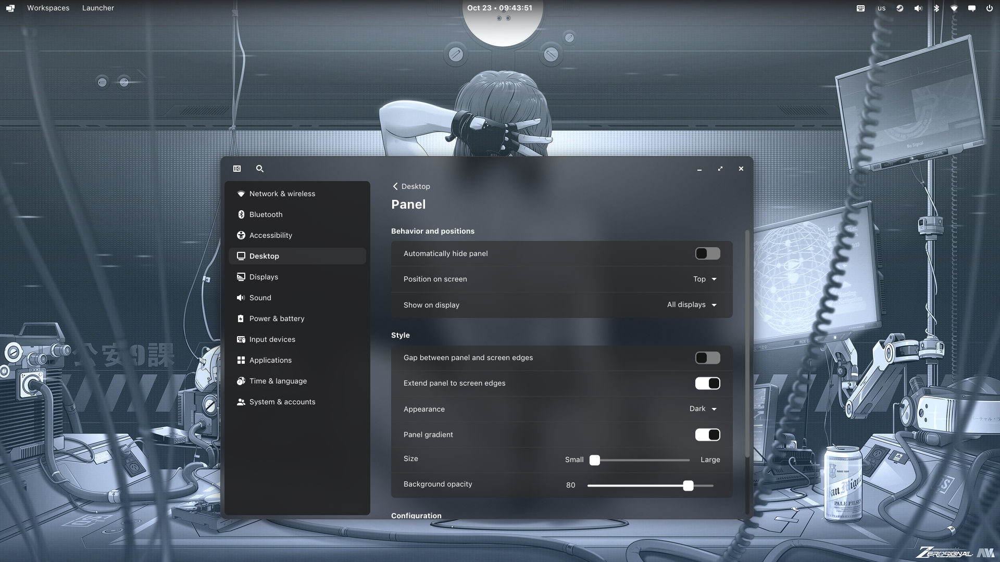

# Penumbra Panel

A softer edge for your COSMIC desktop. Penumbra replaces the panel's flat background with a gradient that fades into your wallpaper.

**Light theme**



**Dark theme**



## Features

- Gradient backgrounds for panels on the top, bottom, left, or right edge.
- Colors follow the panel's appearance, including light and dark themes.
- Gradient strength follows **Background opacity** in COSMIC Settings.
- Adaptive fade size: 32 px panel → 96 px gradient, 48 → 144, 64 → 192.
- Auto-hide moves and fades the background with the panel.
- Matching 200 ms fades between the gradient and the maximized background.
- A **Panel gradient** switch in Settings, independently for the panel and dock.

When a window is maximized, the background becomes uniform at 96% opacity (4% transparency). Restoring the window brings the gradient back. With **Gap** enabled, the effect and its switch are disabled; turning Gap off restores your saved setting.

## Compatibility

The first release supports **Arch Linux**, **COSMIC 1.9.0**, and these exact packages:

| Package | Version |
| --- | --- |
| `cosmic-panel` | `1:1.9.0-1` |
| `cosmic-settings` | `1:1.9.0-1` |

The ready-made binaries require **Linux x86_64** and **glibc 2.44 or newer**. A source build uses your local toolchain and libraries. Other COSMIC versions and distributions need a port of the patches and installer.

Penumbra installs patched versions of both the panel and Settings for your user. The system packages stay in place. These are full programs, so another custom replacement for either program must be combined with these patches. Pulsar Clock remains a separate applet and can be used alongside Penumbra.

## Easy install: ready-made binaries

Download the binary archive from [Releases](https://github.com/motixo/penumbra-panel/releases/latest), or run:

```sh
curl -fLO https://github.com/motixo/penumbra-panel/releases/latest/download/penumbra-panel-linux-x86_64.tar.gz
curl -fLO https://github.com/motixo/penumbra-panel/releases/latest/download/SHA256SUMS
sha256sum --check --ignore-missing SHA256SUMS
tar -xzf penumbra-panel-linux-x86_64.tar.gz
cd penumbra-panel
./install.sh
```

Run as your normal desktop user, without `sudo`. The archive includes both compiled programs, the installer and the uninstaller. No Rust toolchain or local compilation is required.

The installer checks package versions, both binary checksums, and whether both programs can run before replacing a launcher. Existing preferences are preserved during updates. The default profile is `Panel`; select another existing profile with `--profile NAME`, or use `--no-activate` to keep every gradient preference unchanged.

**Log out and back in after installing**, then open:

**Settings → Desktop → Panel → Style → Panel gradient**

Use the same switch on the **Dock** page for the dock. Set **Gap** off and adjust **Background opacity** to change gradient strength. The switch and opacity changes apply immediately once the patched programs are running.

Your session's `PATH` must put `~/.local/bin` before `/usr/bin`, so COSMIC can find the local launchers. The installer reports when the current PATH needs adjustment. Installation leaves the running panel, applets, and settings daemon running.

## Build it yourself

Install the build tools and development libraries on Arch:

```sh
sudo pacman -S --needed base-devel rust git python clang cmake pkgconf \
  fontconfig freetype2 wayland libxkbcommon libinput libpulse libpipewire \
  libglvnd dbus systemd-libs dav1d
```

Build and install:

```sh
git clone https://github.com/motixo/penumbra-panel.git
cd penumbra-panel
./install.sh --from-source
```

This downloads both upstream workspaces at their pinned `epoch-1.9.0` commits, checks and applies the patches, runs the regression tests, and builds optimized release binaries using their original `Cargo.lock` files. Installation begins only after both builds and runtime checks succeed.

To build without installing, or use fewer parallel jobs:

```sh
./install.sh --from-source --build-only
./install.sh --from-source --jobs 2
```

`--profile NAME` and `--no-activate` also work with source builds. Source and build files are kept under `~/.cache/penumbra-panel/`. Set an absolute `CARGO_TARGET_DIR` to reuse compiled dependencies across builds. Internet access is needed to fetch upstream sources and dependencies.

### Corresponding release source

Each release also includes `penumbra-panel-vVERSION-source.tar.gz`. It contains the exact patched Panel and Settings workspaces, their original license notices, vendored Cargo dependencies, and the release tools. To build from that archive, enter each workspace and run:

```sh
cd panel
cargo build --release --locked --offline -p cosmic-panel-bin
cd ../settings
cargo build --release --locked --offline -p cosmic-settings
```

The vendor configurations are included. A compatible Rust toolchain and system development libraries are still required.

## Update

Download and install the latest binary archive again. From a source checkout:

```sh
git pull --ff-only
./install.sh --from-source
```

Saved gradient settings, panel layout, opacity, applets, and clock preferences are preserved. The new programs load after logging out and back in. Reopen Settings to load its new executable.

After either supported Arch package changes, the launchers automatically select the stock programs on their next start. Use a compatible Penumbra release for the new COSMIC version; source builds also check the supported versions. This patch does not prevent system updates.

## Uninstall

```sh
./uninstall.sh
```

Then log out and back in and reopen Settings. This removes the local launchers and binaries, restoring the system programs. Gradient preferences remain for a later reinstall. To remove those too:

```sh
./uninstall.sh --purge
```

The uninstaller checks launcher ownership and preserves any replacement installed by another project.

## Installed files

| Purpose | Default location |
| --- | --- |
| Launchers | `~/.local/bin/cosmic-panel`, `~/.local/bin/cosmic-settings` |
| Binaries | `~/.local/share/penumbra-panel/versions/` |
| Installer state | `~/.local/state/penumbra-panel/` |
| Build cache | `~/.cache/penumbra-panel/` |
| Gradient preferences | `~/.config/cosmic/com.system76.CosmicPanel.PROFILE/v1/top_edge_gradient` |

Data, state, configuration, and cache respect their XDG environment variables. The preference key keeps its earlier name for compatibility with the original local patch. The installer can replace that patch's managed launchers while retaining its preferences.

## Development

```sh
python3 -m unittest discover -s tests -v
bash -n install.sh uninstall.sh build-from-source.sh
python3 scripts/build_release.py ./dist
```

The release command builds and tests both programs, vendors their dependencies, and produces binary and source archives with `SHA256SUMS`. The **Build binary release** GitHub Actions workflow runs the same process in Arch Linux and publishes the version from `release.json`.

The rendering surface has an empty input region, so the gradient does not intercept clicks outside the panel. The fade follows the panel's edge, size, output scale, and auto-hide motion. Maximized behavior follows COSMIC's existing window detection; keep `keep_style_on_maximize` disabled to use the uniform maximized background.

## License and upstream

[GPL-3.0-only](LICENSE). Based on [COSMIC Panel](https://github.com/pop-os/cosmic-panel) and [COSMIC Settings](https://github.com/pop-os/cosmic-settings) by System76 and their contributors. See [NOTICE](NOTICE) for the exact upstream commits and attribution. This is an independent customization.
